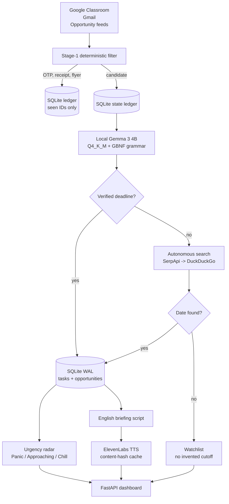

I was registered for the two previous challenges too, but I was too lazy (*binge-watching Black Clover :)*) to submit anything. When I saw this challenge and read the word **"LAZY"**, I knew this one was for me. I got up with a marker in my hand, stared at the whiteboard thinking about what I needed, looked at my phone, and realised I had missed my class (*online, because my college flooded ;-;*), which led me to this idea: what if I build a system that takes in all the stuff from my emails (both personal and college) and Google Classroom, generates an audio summary of it (so I can build this and then completely ignore it)? **THEN I STARTED OVERTHINKING** whether this was a good idea, and finally I gave up and said, **"I need this, so let's make this thing."**

## What I Built

Hermes is a local-first academic triage engine and opportunity radar for one very distractible student (me :)). **There is no chat box and no prompt.** It starts with FastAPI, polls Google Classroom, Gmail, and opportunity feeds, throws out the noise, extracts real deadlines, checks the web when an opportunity date is missing, and writes everything to SQLite. The dashboard reads that state.

The loop has five visible outcomes:

- **Panic** for cutoffs under 6 hours.
- **Approaching** for the next 24 hours.
- **Chill** for anything beyond that.
- **Watchlist** for items whose cutoff has not been announced (no guessing dates).
- **Opportunity matches** for hackathons, fellowships, and internships scored against my stack.

A local `llama-server` runs `gemma-3-4b-it` at Q4_K_M. The model extracts structure; it does not get to invent a timestamp. A 60-second English briefing turns the radar into audio through ElevenLabs. If the API key is missing, the dashboard switches to browser speech. **The app still works.**

## Demo & Telemetry Receipts


The task rows in that image come from my local Hermes instance. The Render demo uses the mock judge dataset, so its counts will differ. **The telemetry strip is not hardcoded.** It is fetched from `GET /api/telemetry/gemma`, which probes the local llama-server and `nvidia-smi` on every cache miss. I removed the old hardcoded "6 GB VRAM" and "50 tok/s" labels because a screenshot should not be the source of truth.

**Live demo:** [athena-hermes.onrender.com](https://athena-hermes.onrender.com). The free instance runs the cloud sandbox profile, so its telemetry strip will show the heuristic fallback instead of the local GPU numbers.

These are readings from the machine sitting under my desk:

| Measurement | Reading |
| :--- | :--- |
| Model weights | `gemma-3-4b-it`, Q4_K_M, 2.48 GB on disk |
| GPU | NVIDIA RTX 4050 Laptop GPU, 6.00 GB VRAM |
| VRAM in use | 4.08–4.34 GB |
| Generation | 42–60 tok/s; the dashboard probe showed 42.6 tok/s in this screenshot |
| Prompt evaluation | 109.5–132.6 tok/s on short probes; ~517 tok/s on long extraction prompts |
| First token | 48–113 ms depending on prefix cache state |
| Dashboard probe latency | 234.9 ms in this screenshot |
| Full email extraction | ~2.9–3.3 s |
| Briefing script | ~4.1–4.2 s |
| SQLite dashboard read | 0.3–0.4 ms cold; WAL enabled, `busy_timeout=5000` |
| Tests | 63 passed in 0.43–0.50 s with `ResourceWarning` treated as an error |

Two details make those numbers less like a launch slide and more like a measurement:

1. The telemetry endpoint has a 10-second cache, so opening the dashboard does not hammer the GPU.
2. The test command is `uv run pytest -q -W error::ResourceWarning`. **A green suite with leaked SQLite handles is not green.**

The run in the screenshot shows 16 active items, 15 unconfirmed items on the Watchlist, and 10 ranked opportunities. The counts are not fixed; they move with the sync and the current date.

## Why Open Innovation Matters

### Student privacy: FERPA by architecture

A student inbox is not a generic text corpus. It contains roll numbers, grade disputes, medical accommodations, faculty drafts, and enough context to identify a person without a name field. Sending whole email bodies to a closed hosted model makes every one of those messages someone else's data-processing problem.

Hermes keeps extraction on the laptop. Gmail and Classroom tokens stay on disk. Email bodies go to `llama-server` over `127.0.0.1`, not to an inference vendor. The database is local SQLite. When I enable ElevenLabs, only the generated briefing script leaves the machine, never the raw email. I can disable voice entirely and let the browser speak the same script.

**FERPA is a US law; the design principle travels.** Student data should not leave the student's machine just because a model is convenient.

### The token bill is zero

A hosted model charges per token. Forty emails a day, every day, add up even before retries, classification mistakes, and the occasional 1,500-character body. Gemma 3 4B runs on open weights I already downloaded. **The inference cost is $0.00.** The laptop and the electricity are real; the token meter is not.

That matters for a student tool. A free tier with a hard quota teaches you to ration your own inbox. **A local model does not.**

### It still works when the campus Wi-Fi does not

Okay, this one actually saved me during the flood. The last sync sits in SQLite, so the radar, watchlist, and briefing script are still there when the Wi-Fi dies and local inference keeps running. If the network drops halfway through a sync, the ledger doesn't get half-written because the ledger row, the task, and the opportunity all go in one transaction, so a retry starts from a clean state instead of some weird half-synced mess. If llama-server is down, the heuristic fallback takes over instead of throwing a 500 at my face.

**University Wi-Fi always dies exactly when a submission window is closing. That's not a hypothetical. That's a law.**

### Open weights are inspectable

The other thing I like about local weights is that I can see what the thing is doing. The prompt is in the repo. The GBNF grammar is in `app/grammars`. The date filter is a few lines of Python, and the SQLite schema is right there, so if something looks wrong I can follow the whole path from email to radar without opening a vendor dashboard. Swapping the model is one env var. **No vendor call, no pricing page, no "contact sales".**

I can run the whole thing with no account, no card, and no analytics leaving the box. For a tool that touches grade emails and faculty stuff, that matters more than whatever benchmark is trending this week.

## Architecture & Deterministic Safeguards

Here's the whole loop. I'm not going to pretend it's the prettiest diagram, but it's the actual flow.



> **The rule under all of it:** a missing date is data, not an invitation to invent one.

### Layer 1: the deterministic pre-filter

The first pass is sender and keyword matching. OTPs, receipts, password resets, bookstore sales, club flyers, and lost-and-found stuff are all gone before they touch the GPU, because **a bookstore email does not deserve three seconds of my laptop's life**.

If a sale email also says "assignment due", it gets a second look and the academic signal wins. The model is good at pulling one deadline out of a clean email, but *it's not good at deciding whether a hoodie coupon is urgent*.

### Layer 2: constrained Gemma extraction

Gemma gets the email body, sender, subject, and the received time in `Asia/Kolkata`. The output is forced through a GBNF grammar checked into `app/grammars/deadline_extraction.gbnf`, and then Pydantic validates it.

A small slice:

```gbnf
category ::= "\"ACADEMIC_DEADLINE\"" | "\"OPPORTUNITY_DEADLINE\"" | "\"INFORMATIONAL_ALERT\"" | "\"SPAM_NOISE\""
number ::= "-"? [0-9]+ ("." [0-9]+)?
```

Every rule is on one line because llama-server threw a 400 at me when I formatted them nicely. *Cool.* **The grammar is not decoration.** It stops the model from replying with a prose apology where the JSON should be.

Dates are where I trust the model the least, so "tonight at 11:59 PM" gets resolved against the email's timestamp in IST, then converted to UTC, and the model's own `exact_deadline_iso` is only a suggestion. It gets accepted if it falls between 30 days before the email and 365 days after it. If it looks like a hallucination, it goes to the Watchlist. **No Panic lane, no fake timer.**

### Layer 3: autonomous search, with a negative cache

When an opportunity has no date, the tool hits SerpApi, falls back to DuckDuckGo's HTML endpoint, and asks Gemma to pull a date out of the snippets, then caches a positive result for 30 days and a negative one for 2. The short negative TTL is on purpose, because a conference that hasn't announced its cutoff today might announce it tomorrow, and I don't want a stale "no date" sitting in cache when the real date finally drops.

**Search is a tool, not god.** If no future deadline comes back, the item stays on the Watchlist. **It doesn't get a default seven days.**

## Bugs I Hit Along the Way

These five are the ones that actually changed the design. Some were my fault, some were the model's, and one was just me not closing database connections. The fixes are more useful than the feature list, so here they are.

### 1. The seven-day deadline that did not exist

The first version of the opportunity fetcher had a fallback. If a page didn't expose a deadline, I set one seven days out. The dashboard looked complete. **It was also lying.**

I removed every default timestamp. Devpost now handles ISO dates with a `Z` suffix and cross-year ranges. Unstop and Classroom parsers return `None` for missing or partial dates, and those items go to the Watchlist with "cutoff unconfirmed" in a separate lane with no timer.

**A missing date isn't a UX problem to hide. It's a fact to display.**

### 2. The 384-byte silent MP3

ElevenLabs failed once and the old audio path wrote a 384-byte MPEG frame into `data/audio_cache/`. Keyed by content hash. Every later request found a "cache hit" and played silence. **The dashboard looked like it had audio. It didn't.**

Now the service rejects anything under 2 KB, checks for an ID3 tag or a valid MPEG frame header, writes to a temp file, fsyncs it, and moves it into place with `os.replace`. A failure leaves no cache entry. The route returns `503`, and the browser speech fallback takes over.

**Silence with a play button is a lie.** *I'd rather hear the Chrome robot voice.*

### 3. The OAuth scope shuffle

Google's OAuth flow compares requested scopes with the scopes in the token. If the order changes, `oauthlib` can throw `ScopeChanged` even when the permission set is identical. Multi-account auth made that easy to reproduce.

`scripts/auth_google.py` sets `OAUTHLIB_RELAX_TOKEN_SCOPE=1` before importing the flow. That relaxes the order check, not the consent screen. The active manifest is ignored by git, and `config/accounts.example.json` contains placeholders only. *This one cost me an evening, and I still don't fully forgive oauthlib.*

### 4. The midnight IST drift

A 20:00 IST email is 14:30 UTC. The old code took that UTC datetime and called `.replace(hour=23, minute=59)`, which made it 23:59 UTC. That's 05:29 IST the next morning. A deadline due in four hours moved to the next day.

The resolver now converts to `ZoneInfo("Asia/Kolkata")` first:

```python
email_ist = to_utc(email_dt).astimezone(ZoneInfo("Asia/Kolkata"))
tonight = email_ist.replace(hour=23, minute=59, second=0, microsecond=0)
return tonight.astimezone(timezone.utc)
```

Test coverage includes explicit times, midnight, noon, and a 20:00 IST anchor. The model still sometimes spits out `23:59:00Z` for "tonight at 11:59 PM". The code doesn't trust it. **Good. Neither should you.**

### 5. The SQLite leak under rapid polling

A stress run with repeated syncs gave me 167 `ResourceWarning` messages. Connections were being opened in helper methods and left for the garbage collector. Under WAL and concurrent reads, that's a slow way to build a file-handle leak.

Now every connection goes through a context manager. The DB sets `PRAGMA journal_mode=WAL`, `PRAGMA busy_timeout=5000`, and `PRAGMA synchronous=NORMAL`, and the ledger and extracted tasks go in one transaction, so a failed sync doesn't leave a row claiming an email was handled when the task never got saved. The full suite runs with `-W error::ResourceWarning` and passes.

`NORMAL` is a deliberate trade. **This is a cache and a task ledger, not a bank.** WAL keeps readers from blocking writers. A power loss can cost the last few transactions, but it won't corrupt the database. The next sync rebuilds what it can.

63 tests pass in about half a second. *I'm not saying that makes me a good engineer.* **I'm saying the suite runs before I push.**

## The Lazy Payoff & Partner Prize Mappings

**Slow and Steady** was the Week 3 theme, and I read the hidden clause as **Rewards Laziness**, so here's the payoff.

Before Hermes, my morning was the Classroom tab, the Gmail tab, an internship board, a hackathon feed, a calendar, and the feeling that I had forgotten something. **That was 25 minutes of scanning before I wrote a line of code.**

Now it's one page. Background sync refreshes the connectors. Extraction runs locally and lands in SQLite. The radar gives me three lanes and a Watchlist. If I want audio, the briefing reads the important part in about 60 seconds while I put my shoes on.

The time balance sheet is not complicated:

| Before | After |
| :--- | :--- |
| 25 minutes of manual tab scanning | 3-second status check; extraction runs in the background |
| Deadlines found by memory | SQLite ledger plus radar bands |
| Unknown dates turned into fake dates | Explicit Watchlist with no timer |
| Silent MP3 dead ends | ElevenLabs audio or browser speech, never fake silence |
| Repeated LLM calls for the same email | Persistent ledger skip, plus content-hash audio cache |

I still do the assignments. Hermes isn't writing the Raft implementation for me. It just makes sure I know it's due before the upload window closes. *And I can go back to Black Clover without feeling guilty.* **That's the real KPI.**

### Best Use of Gemma

**Gemma 3 4B is doing the extraction, not sitting in a chat bubble.** It runs locally through llama.cpp at Q4_K_M, gets a GBNF grammar, returns a validated schema, and falls back to deterministic parsing when the server is offline, so the no-GPU path still works. On the RTX 4050, a full email extraction takes about 3 seconds and generation stays around 48-60 tok/s.

The part I care about is the boundary. **The model reads the messy text, and Python owns the clock.** That's how a 4B model can sit in a real path without inventing deadlines.

### Best Use of ElevenLabs

**The briefing is the actual lazy part.** I can listen to a 60-second English summary while I put my shoes on, and ElevenLabs gets the generated script, not the raw inbox. The audio cache is keyed by a SHA-256 hash of voice ID plus script text. The service checks MP3 headers and minimum size, writes atomically, and returns `503` when synthesis is unavailable, so the failure path is as useful as the happy path.

**A missing key should give me browser speech, not a silent file with a play button.**

### Best Use of Render

`render.yaml` defines the judge sandbox as a Render web service. The live demo is [athena-hermes.onrender.com](https://athena-hermes.onrender.com). Because the free instance has no GPU, `llama-server` telemetry reports offline and the deterministic paths handle extraction. *That's on purpose.* A judge can open the dashboard, hit sync, inspect the radar, and test the Watchlist without a Google login or a local model.

The blueprint keeps `ELEVENLABS_API_KEY` in the dashboard with `sync: false`, binds Uvicorn to `$PORT`, uses the same FastAPI app as local mode, and ships the mock dataset, so a judge can reproduce the demo without a local setup.



---

**The best tool is the one that lets me be bored.** I want a morning that is coffee, one look at three lanes, one tap on a briefing, and then work. *Hermes isn't a second brain. It's a bouncer for my inbox, running on the laptop I already own.* **That's the kind of laziness I can defend.**

*Anyway, the marker is still on my hand. At least now the inbox checks itself. I'm going back to Black Clover.*

Shoutout to my teammate @attlar.
